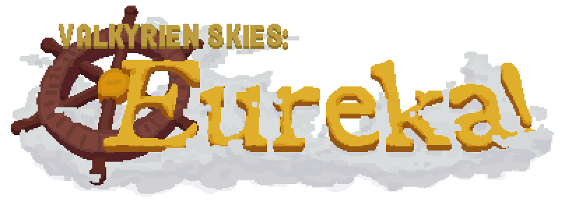

<p align="center">

</p>

---
<p align="center">
<a href="https://www.valkyrienskies.org/"></a>
<a href="https://www.curseforge.com/minecraft/mc-mods/eureka-ships"></a>
<a href="https://modrinth.com/mod/eureka"></a>
<a href="https://wiki.valkyrienskies.org/wiki/Eureka"></a>
<a href="https://discord.gg/dWwM8G3"></a>
</p>

Eureka is a simple add-on for Valkyrien Skies that fits with vanilla aesthetic and is easy and fun to use.

Build and design your own ship out of ordinary (or modded!) Minecraft blocks, place a Ship Helm, shift + right-click, assemble, and watch your creation suddenly infuse with physics. No longer are your Minecraft builds bound to remain forever static, sitting in the same place for all eternity.


## ⚠️ Unofficial Minecraft 26.2 / NeoForge Fork

This is an **unofficial community fork** of [ValkyrienSkies/Eureka](https://github.com/ValkyrienSkies/Eureka),
ported to run on Minecraft 26.2. It is **not affiliated with or
endorsed by** the ValkyrienSkies team. For the official mod, releases,
and support, please use the links and channels above.

**Requirements:** NeoForge only (Fabric and legacy Forge have been
dropped for this port), Java 25, NeoForge `26.2.0.12-beta`, and the
[Valkyrien Skies 2 26.2 fork](https://github.com/tonchin04/Valkyrien-Skies-2)
(not the official VS2 release, which doesn't yet support 26.2).

**Known limitations:**
- Minor visual flicker can occur when moving through a large,
  section-spanning ship-mounted glass/translucent structure (a VS2-
  side rendering timing issue, see the VS2 fork's README).
- Third-party mod compatibility has not been updated/tested for 26.2.

**Building:** This fork depends on the VS2 26.2 fork via `mavenLocal`
(no public Maven repository is set up for it yet). To build both from
source:

```bash
git clone https://github.com/tonchin04/Valkyrien-Skies-2
git clone https://github.com/tonchin04/Eureka
cd Valkyrien-Skies-2 && ./gradlew publishToMavenLocal
cd ../Eureka && ./gradlew :forge:build
```

## Dependencies
> [!NOTE]
> Eureka comes with an integrated dependency downloader that will do all the hard work for you! Just download the Eureka JAR file and launch the game.

- [Valkyrien Skies](https://github.com/ValkyrienSkies/Valkyrien-Skies-2)
- [Architectury API](https://www.curseforge.com/minecraft/mc-mods/architectury-api)
- [Cloth Config API](https://www.curseforge.com/minecraft/mc-mods/cloth-config)
- [Kotlin For Forge](https://www.curseforge.com/minecraft/mc-mods/kotlin-for-forge) (Forge users only)
- [Fabric API](https://www.curseforge.com/minecraft/mc-mods/fabric-api) (Fabric users only)
- [Fabric Language Kotlin](https://www.curseforge.com/minecraft/mc-mods/fabric-language-kotlin) (Fabric users only)
- [Mod Menu](https://www.curseforge.com/minecraft/mc-mods/modmenu) (Fabric users only)
